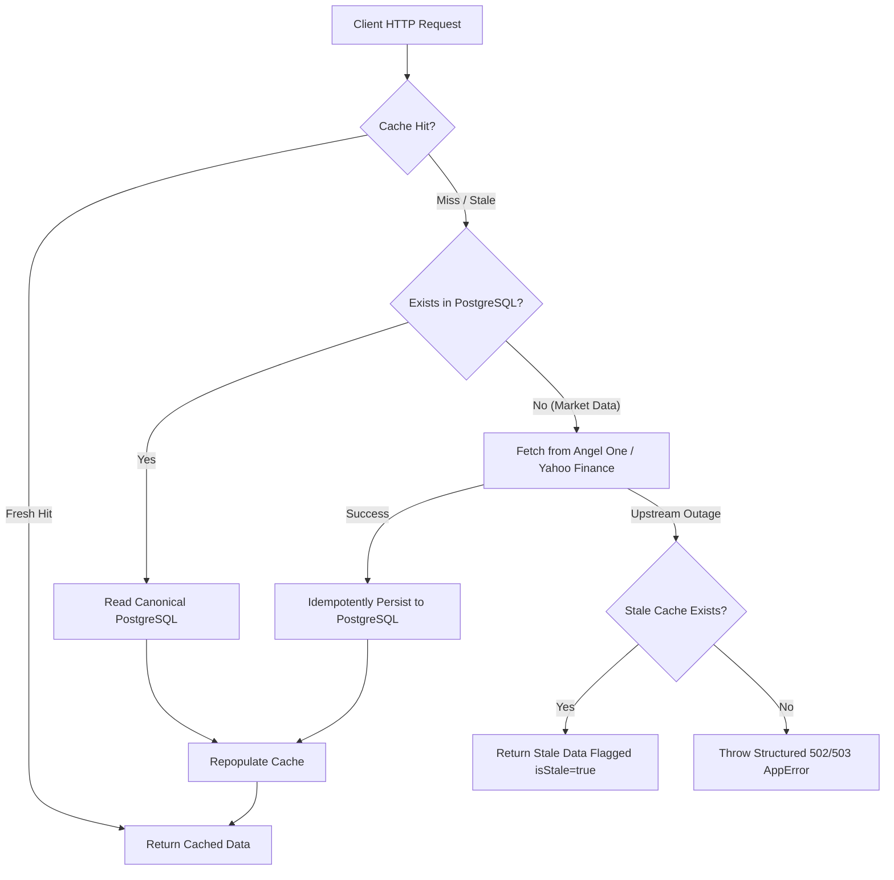

# EquityLensAI — Data Persistence Policy

**Author:** Antigravity AI  
**Scope:** Core Architecture, Data Engineering & Storage Lifecycle  
**Classification:** Institutional Data Architecture  
**Status:** Canonical Platform Standard  

---

## 1. Core Principles

The EquityLensAI data tier separates durable storage, versioned reproducible calculations, and transient operational acceleration according to three non-negotiable rules:

1. **PostgreSQL is the Canonical Truth:** All user-generated configurations, audited financial statements, historical daily observations, and security master definitions must be durably stored in PostgreSQL.
2. **Caches Accelerate Reads, Not Storage:** Redis or in-memory caches exist purely to reduce latency and shield upstream providers from request bursts. Expiring a cache key or restarting a cache node must never result in data loss.
3. **Reproducibility Through Immutability:** Financial ratios, screen results, and research evidence must record the exact calculation version, reporting period, and source timestamps so that any figure can be reconstructed and explained.

---

## 2. Data Classification Matrix

| Category | Description | Canonical Storage | Cache Tier | Invalidation / Retention Policy |
| :--- | :--- | :--- | :--- | :--- |
| **A. Durable Canonical Data** | Security master (ISIN, exchange, symbol, company name, sector, lot size, tick size). | PostgreSQL (`market_instruments`, `companies`, `company_listings`) | CacheManager (`profile:{EXCH}:{SYM}`) | Retained indefinitely; updated on corporate action or scrip master re-ingestion. |
| **B. Durable Historical Observations** | Historical daily OHLCV prices, trading volumes, and adjustment statuses. | PostgreSQL (`market_daily_observations`) | CacheManager (`history:{EXCH}:{SYM}:{interval}:{from}:{to}`) | Daily candles retained indefinitely; unique constraint on `(exchange, symbol, date)`. |
| **C. Durable User-Generated Data** | Profiles, preferences, watchlists, portfolios, transactions, alerts, saved screens, research reports. | PostgreSQL (`user_profiles`, `watchlists`, `portfolios`, `alert_rules`, `saved_screens`, `research_projects`) | User-scoped cache (`user:{userId}:{namespace}:{id}`) | Retained until explicitly deleted or archived by the authenticated owner. |
| **D. Reproducible Derived Data** | Standardized financial ratios (P/E, P/B, ROE, ROCE, Health Score), screener execution snapshots. | PostgreSQL (`financial_screener_metrics`, `screener_runs`) | CacheManager (`financial:{EXCH}:{SYM}:v{calcVersion}`) | Versioned by `CALCULATION_VERSION` ('1.0.0'); recomputed when underlying filings are updated. |
| **E. Temporary Cache** | Real-time quote snapshots, market overview indices, intraday tick candles. | Volatile Memory / Redis | MemoryCache (`quote:{EXCH}:{SYM}`, `overview:{market}`) | 10s–15s fresh TTL, 60s–90s stale-if-error TTL; evicted automatically. |
| **F. Temporary Operational State** | Rate limit sliding windows, alert job concurrency mutexes, ingestion telemetry. | Volatile Process Memory / Redis | In-Memory Sliding Window (`RateLimiter`) | Bounded windows (1 min sliding window); reset on process termination. |
| **G. Restricted Licensed Data** | Proprietary broker tick feeds, raw third-party announcement documents, third-party full news articles. | External Provider Origin (Not stored locally) | Ephemeral Cache Only | Only content hashes and normalized metadata stored locally; raw proprietary feeds not persisted. |

---

## 3. Storage Hierarchy & Fallback Mechanics

### Fallback Invariants:
1. **No Dummy Fallback Data:** If both upstream providers and canonical database layers fail, the platform returns a structured HTTP 502/503 `AppError` (`MARKET_DATA_UNAVAILABLE` or `DATABASE_NOT_CONFIGURED`). The platform strictly prohibits fabricating placeholder figures.
2. **Deterministic Provenance:** All market records must declare `source` ('angel' | 'yahoo' | 'canonical_db'), `retrievedAt`, `qualityFlag` ('verified' | 'suspect'), and `isStale: boolean`.
