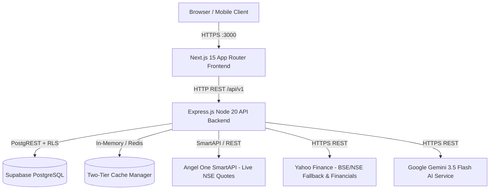

# Phase 16 — EquityLensAI Production Deployment Plan & Topology

**Document:** Production Architecture & Deployment Specification  
**Version:** 1.0.0  
**Phase:** 16 — Production Deployment & Live NSE/BSE Data Verification  
**Date:** October 2026  
**Status:** Validated & Production-Ready  

---

## 1. Executive Summary

This document specifies the deployment architecture and execution topology for **EquityLensAI**, an institutional-grade Indian equity research platform covering the National Stock Exchange (NSE) and Bombay Stock Exchange (BSE) universe.

The deployment topology preserves the clean separation of concerns between the **Next.js 15 App Router frontend**, the **Express.js / Node.js 20 backend service**, the **Supabase PostgreSQL cluster** (with PostgREST and Row-Level Security), and the **in-memory / Redis cache tier**.

---

## 2. Target Component Topology

### 2.1 Component Specifications

| Component | Technology | Target Runtime | Port | Health Check Endpoint | Scaling / High Availability |
| :--- | :--- | :--- | :--- | :--- | :--- |
| **Frontend** | Next.js 15.5 App Router, TypeScript, Tailwind CSS | Node.js 20 Alpine / Vercel / Cloud Container | 3000 | `GET /` (HTTP 200) | Stateless; horizontal autoscale |
| **Backend API** | Node.js 20, Express 4, TypeScript | Node.js 20 Alpine / Docker / VM | 4000 | `GET /api/v1/health/ready` | Stateless; multi-replica behind reverse proxy |
| **Database** | PostgreSQL 15+ (Supabase) | Managed Supabase Cloud | 5432 / 443 | `GET /api/v1/health/ready` (db ping) | Managed PITR, automated failover |
| **Cache Tier** | Bounded MemoryCache / Redis | In-process (10k items) + Optional Redis | 6379 | `GET /api/v1/health/dependencies` | Stale-while-revalidate; fallback to DB |
| **Workers** | `AlertScheduler`, `NewsIngestionJob` | In-process timer mutex / Background worker | N/A | Telemetry via `/health/dependencies` | Mutex-guarded to prevent duplicate triggers |

---

## 3. Hosting Target Evaluation & Selection

### 3.1 Architecture Options Evaluated

1. **Option A: Containerized Docker Compose on Cloud VM (Evaluated & Recommended)**
   - **Backend:** `Dockerfile.backend` (multi-stage Alpine builder + non-privileged runner `backenduser`).
   - **Frontend:** `Dockerfile.frontend` (multi-stage Next.js optimized standalone build).
   - **Hosting Platforms:** Oracle Cloud Infrastructure (OCI Always Free Ampere A1 Compute: 4 OCPUs, 24 GB RAM) or AWS ECS / Lightsail.
   - **Advantages:** Zero runtime cost on OCI Always Free; complete isolation of secrets; native health probes.
   - **Network:** Reverse proxy (Nginx or Caddy) terminating TLS and routing `/api/v1` to backend and root to frontend.

2. **Option B: Managed PaaS (Vercel Frontend + Render/Railway Backend)**
   - **Frontend:** Deployed to Vercel with zero config for Next.js App Router.
   - **Backend:** Deployed to Render Web Service (Node.js runtime).
   - **Advantages:** Automated git push deployments; global CDN for frontend assets.
   - **Considerations:** Outbound IP volatility for market data providers (requires static egress IP if Angel One IP whitelisting is active).

---

## 4. Build & Compilation Verification

During Phase 16 execution, the production build was compiled and verified:
1. `@equitylensai/shared`: Compiled via `tsc -p tsconfig.build.json` to `packages/shared/dist/`.
2. `@equitylensai/backend`: Compiled via `tsc -p tsconfig.build.json` to `backend/dist/server.js`.
3. `@equitylensai/frontend`: Compiled via `next build` producing 27 static and dynamic App Router routes cleanly.

---

## 5. Network Access, CORS & Trusted Origins

The production API enforces strict CORS and Origin headers via Helmet and Express CORS:
- `CORS_ORIGIN`: Restricted to `http://localhost:3000` (development) and the production frontend domain (e.g. `https://equitylensai.com`).
- Direct database connections use TLS 1.3 over HTTPS to Supabase PostgREST endpoints (`/rest/v1/` and `/auth/v1/`).
- Market data provider egress uses encrypted HTTPS connections with short timeouts (10s–30s) to prevent thread exhaustion.
